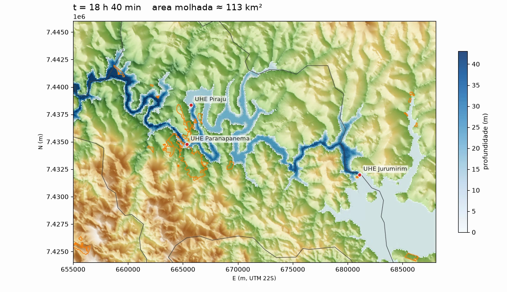

# ANUGA Hydraulic Simulator

Reproducible runner for routing a user-supplied inflow hydrograph (or a prescribed released volume converted to a hydrograph) over a DEM with [ANUGA](https://anuga.readthedocs.io/). Results can be inspected as interactive 3D HTML, rendered as MP4, and overlaid on urban/rural land. Linux and macOS.

## Scope

This is a numerical-model runner, not a dam-safety assessment. It does not estimate a probability of failure, breach geometry or a breach hydrograph; it routes the hydrograph you provide through the terrain. Results are conditional on the supplied DEM, hydrograph, roughness and boundary conditions. The included scenario is hypothetical: not a forecast, not a breach simulation, not validated.

## Features

- Hydrograph from a released volume (triangular or exponential), with a mass-balance check.
- DEM reprojection/clipping with CRS and nodata validation.
- 2D shallow-water simulation (ANUGA) with OpenMP support.
- Urban/rural impact: area and fraction reached per maximum-depth threshold.
- Interactive 3D HTML (time slider), MP4 map view, and ANUGA depth animation.

## Architecture

```
volume / hydrograph.csv --+
DEM (projected, metres) --+--> simulador-hidro (ANUGA) --> output/<label>.sww
inlet.geojson ------------+          |--> simulador-impacto    (urban/rural area)
                                     |--> simulador-visualizar (3D HTML / MP4)
                                     +--> simulador-animar     (ANUGA MP4/GIF)
```

## Quick start

On macOS use conda-forge (`pip install anuga` fails on the OpenMP compile step):

```bash
conda create -p ./.conda -c conda-forge --override-channels python=3.11 \
    anuga rasterio shapely matplotlib pillow ffmpeg geopandas plotly
./.conda/bin/python -m pip install --no-deps -e .

cp config.example.toml config.toml        # then edit paths and model settings
simulador-hidrograma --volume-hm3 7007.52 --duration-h 72 --out data/hydrograph.csv
simulador-hidro --config config.toml
```

Inputs (`data/dem.tif`, `data/inlet.geojson`, `data/hydrograph.csv`) are local and not versioned. See the [technical guide](docs/TECHNICAL_GUIDE.md) for the full procedure.

## Example result

Hypothetical scenario: 7,007.52 hm3 released over 72 h from Jurumirim, 24 h simulated, with urban/rural overlay for Piraju. Inputs are in `scenarios/jurumirim_7007hm3_72h/`; results, assumptions and limitations are in section 7 of the technical guide.



## Repository structure

```
src/jurumirim_sim/      CLI, runner, hydrograph, DEM prep, impact, visualization
scenarios/              versioned inputs of the example scenario
docs/TECHNICAL_GUIDE.md technical documentation
docs/resultados/        example outputs (MP4, peak frame, impact JSON, run metadata)
config.example.toml     run configuration template
data/                   local inputs (git-ignored)
```

## Tests

The repository has no automated tests yet.

## Data and licenses

The DEM, municipal limits and urban areas used in the example are public datasets and are not versioned. Restricted material (PAE/PSB documents, confidential reports, personal data) must not be committed. Details in the technical guide, section 10.

## License

See [LICENSE](LICENSE).
