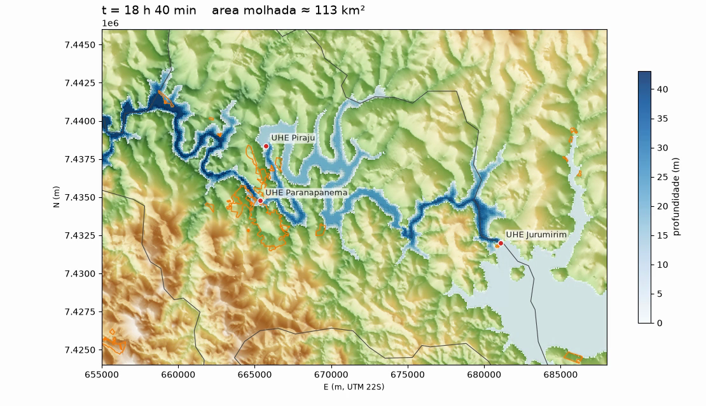

# Cenário exploratório: 7.007,52 hm³ liberados a partir de Jurumirim

> **Cenário hipotético de balanço de massa. Não é previsão, não é ruptura, não é laudo.** Estudo educacional independente; não substitui o PAE oficial, a Defesa Civil ou laudo de engenharia.

## 1. A pergunta

Não se calcula a probabilidade de uma barragem romper nem como ela romperia. Fixa-se uma **premissa de volume** e pergunta-se:

> Se 100 % do volume do reservatório de Jurumirim (7.007,52 hm³, N.A. máximo normal, PAE Jurumirim) chegasse ao vale a jusante, onde a água se espalharia, com que profundidade e quando, passando por Paranapanema e Piraju?

O volume vem do PAE; o **tempo de esvaziamento (72 h)** e a **forma da curva** (triangular, pico em 7,2 h) são **escolhas do cenário**, não dados. Um volume sozinho não define uma vazão: 7 bilhões de m³ em 6 h dariam ~650.000 m³/s de pico; em 7 dias, ~23.000 m³/s. Para comparação, o hidrograma de ruptura hipotética de Paranapanema no PAE usa 2.420 m³/s.

## 2. Como foi feito

| Etapa | Ferramenta | O que faz |
|---|---|---|
| Volume → hidrograma | `simulador-hidrograma` | triangular ou exponencial; **aborta se a integral do CSV não fechar o volume** (tolerância 1e-6) |
| DEM | `simulador-dem` | reprojeta o Copernicus GLO-30 (EPSG:4326) para UTM 22S (EPSG:31982), 30 m, e recorta 33 × 22 km |
| Propagação | `simulador-hidro` | ANUGA 4.1 (águas rasas 2D, volumes finitos), malha ≈ 10.000 m² por triângulo (~100 m), Manning 0,04, OpenMP |
| Impacto | `simulador-impacto` | cruza os triângulos do solver com áreas urbanas (IBGE 2019) e o município de Piraju: área e fração por profundidade máxima |
| Visualização | `simulador-visualizar` | 3D interativo (HTML) e MP4; os quadros são os passos de saída do solver, sem interpolação no tempo |

Entrada da água: linha de 600 m cortando o vale ~1,2 km a noroeste do eixo da barragem (**ponto assumido**, não é a brecha). Bordas: transmissivas. Duração simulada: 24 h (de um hidrograma de 72 h). Arquivos do cenário: [`scenarios/jurumirim_7007hm3_72h/`](../scenarios/jurumirim_7007hm3_72h/).

### Reproduzir
```bash
conda create -p ./.conda -c conda-forge --override-channels python=3.11 anuga rasterio shapely matplotlib pillow ffmpeg geopandas plotly
./.conda/bin/python -m pip install --no-deps -e .
./.conda/bin/simulador-dem COPERNICUS_GLO30.tif --out data/dem.tif --bbox 655000 7424000 688000 7446000
OMP_NUM_THREADS=10 ./.conda/bin/simulador-hidro --config scenarios/jurumirim_7007hm3_72h/config.toml   # ≈ 4 min em 10 threads (Apple Silicon)
./.conda/bin/simulador-impacto output/jur_7007hm3_72h_24h.sww --origin 655000 7424000 --municipios municipios.gpkg --urban areas_urbanizadas.gpkg
./.conda/bin/simulador-visualizar mp4 output/jur_7007hm3_72h_24h.sww --dem data/dem.tif --out output/run.mp4
```
O DEM, os limites municipais e as áreas urbanizadas não são versionados (`data/` é local). O Copernicus GLO-30 e os dados do IBGE são públicos; as fontes e licenças estão no repositório de estudo (`Jurumirim-Flood_Explorer`, `docs/CATALOGO_FONTES.md`).

## 3. Resultados (24 h simuladas)

| Local | Chegada | Prof. máx. |
|---|---|---|
| UHE Piraju (barragem) | ≈ 5 h 20 | ≈ 33 m |
| UHE Paranapanema | ≈ 6 h 30 | ≈ 46 m |
| Entorno do centro de Piraju (posição aproximada) | ≈ 7 h | ≈ 46 m |
| Pico no município de Piraju | **18,5 h** | **54,6 m** (54,2 m aos 24 h) |
| Área molhada total aos 24 h | | 112 km² |

(Chegada e profundidades por local vêm da rodada-teste de 12 h; o pico é da rodada de 24 h.)

**Piraju: 506 km², dos quais 427 km² no domínio. Área urbanizada IBGE: 8,3 km²; rural: 497 km².**

| Prof. máx. acima de | Urbana | Rural |
|---|---|---|
| 0,1 m | 0,76 km² (9,1 %) | 72,9 km² (14,6 %) |
| 0,5 m | 0,75 km² (9,0 %) | 72,0 km² (14,5 %) |
| 1,0 m | 0,74 km² (8,9 %) | 71,0 km² (14,3 %) |
| 2,0 m | 0,68 km² (8,2 %) | 69,1 km² (13,9 %) |

Números completos: [`resultados/impacto.json`](resultados/impacto.json). Vídeo: [`resultados/jurumirim_7007hm3.mp4`](resultados/jurumirim_7007hm3.mp4).



### Leitura
- Nesse cenário e com esse terreno, a água **fica no vale do rio**; atinge cerca de **9 % da área urbanizada** e cerca de **14 % da área rural** de Piraju. As manchas urbanas atingidas ficam junto à barragem de Paranapanema.
- A profundidade **parou de subir** (pico às 18,5 h) e já cai um pouco aos 24 h. Como a entrada de água continua alta, **não há recessão de verdade** nessa janela.
- Entre 0,1 m e 2 m os números quase não mudam: onde molha, molha fundo.

## 4. O que isto NÃO mostra
- **Não prova que a cidade inteira seria poupada**, nem que seria atingida em qualquer outro cenário. É um resultado condicional a estas entradas.
- **DEM de 30 m (Copernicus GLO-30)** é um modelo de superfície: não resolve ruas, edificações nem a **batimetria do rio**; erro vertical de metros. As profundidades de dezenas de metros no talvegue são ordem de grandeza.
- **Resolução da malha (~100 m)** é grossa para uma cidade.
- **Cascata não modelada.** Paranapanema e Piraju entram como terreno elevado: a água as contorna ou transborda, sem ruptura nem operação de vertedouro. Se o volume excede a capacidade de cada barragem, passar por cima ou romper é esperado; isso não está representado.
- **Reservatórios no DEM** aparecem como superfície plana (Jurumirim ≈ 564 m). A profundidade calculada sobre eles é a elevação acima do nível original.
- **Bordas transmissivas.** A água sai do domínio pela borda oeste ainda com mais de 30 m; o que ocorre a jusante do recorte não está modelado.
- **Conservação de massa:** o volume do hidrograma fecha, mas a vazão de saída pelas bordas **não foi medida**; portanto o balanço do domínio não foi verificado de ponta a ponta.
- **Sem calibração nem validação** contra observações; **sem teste de sensibilidade** (ponto de entrada, tempo de esvaziamento, rugosidade, malha).
- **Sem revisão** por engenheiro hidráulico.

## 5. Próximos passos sugeridos
1. Malha mais fina só ao redor de Piraju, com domínio estendido para oeste.
2. Medir o balanço de massa (vazão de saída pelas bordas).
3. Sensibilidade: ponto de entrada, tempo de esvaziamento, Manning.
4. Obter terreno e batimetria de melhor qualidade, e o hidrograma/memorial dos PAEs (CBA/CTG).
5. Representar as barragens de Paranapanema e Piraju (galgamento, vertedouro, ruptura) com premissas declaradas.
