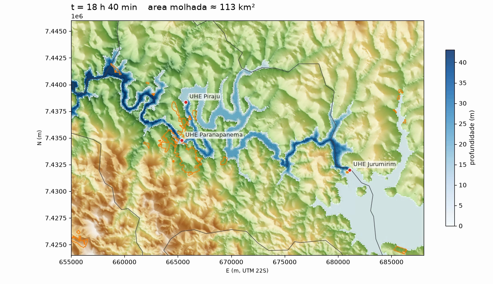

# Technical Guide

Hydraulic Simulator (ANUGA) for Linux and macOS: routing of a user-supplied inflow hydrograph over a DEM.

## Contents

1. [Scope and limits](#1-scope-and-limits)
2. [Architecture](#2-architecture)
3. [Requirements and installation](#3-requirements-and-installation)
4. [Inputs](#4-inputs)
5. [Command reference](#5-command-reference)
6. [Running a scenario](#6-running-a-scenario)
7. [Reference scenario: 7,007.52 hm3 released from Jurumirim](#7-reference-scenario-700752-hm3-released-from-jurumirim)
8. [Interpretation of results](#8-interpretation-of-results)
9. [Known limitations](#9-known-limitations)
10. [Data handling, sources and licenses](#10-data-handling-sources-and-licenses)
11. [Troubleshooting](#11-troubleshooting)
12. [Open work](#12-open-work)

## 1. Scope and limits

- The software routes a supplied inflow hydrograph through terrain and writes an ANUGA `.sww` result. It does **not** estimate dam-failure probability and does **not** compute breach geometry or a breach hydrograph.
- A hypothetical input must not be described as the breach hydrograph of any dam unless an authoritative source and engineering validation support it.
- A modeled inundation extent is conditional on the DEM, bathymetry, structures, roughness, initial water level, inlet hydrograph and boundary conditions. It does not demonstrate what is physically possible for every conceivable event.
- The same engine can be configured for UHE Jurumirim, UHE Paranapanema and UHE Piraju, each with its own terrain, inlet, hydrograph, boundaries and configuration. The repository does not contain validated inputs for those reaches. A cascade requires connected reach models with consistent upstream/downstream boundary conditions; running unrelated configurations does not simulate cascade interaction.
- Restricted material (PAE/PSB documents, confidential reports, personal data) and large raw datasets must not be committed. `data/` is git-ignored.
- Target platforms are Linux and macOS. No Windows-only desktop application is required (HEC-RAS is not used).
- Any public-safety conclusion requires review by a qualified hydraulic engineer.

## 2. Architecture

```
volume / hydrograph.csv --+
DEM (GeoTIFF, projected) -+--> simulador-hidro (ANUGA 2D shallow water) --> output/<label>.sww
inlet.geojson ------------+                                                   |
                                          +-----------------+-----------------+
                                          |                 |                 |
                                  simulador-impacto  simulador-visualizar  simulador-animar
                                  (urban/rural area) (3D HTML / MP4)       (ANUGA MP4/GIF)
```

Package `src/jurumirim_sim/`:

| Module | Role |
|---|---|
| `cli.py` | input validation and ANUGA runner (`simulador-hidro`); builds the mesh from the raster |
| `hydrograph.py` | volume to hydrograph (`simulador-hidrograma`) |
| `prepare_dem.py` | DEM reprojection and clipping (`simulador-dem`) |
| `impact.py` | urban/rural area reached per maximum-depth threshold (`simulador-impacto`) |
| `visualize.py` | interactive 3D HTML and MP4 map view (`simulador-visualizar`) |
| `animate.py` | ANUGA depth animation (`simulador-animar`) |

Repository layout:

```
src/jurumirim_sim/        package
scenarios/                versioned inputs of the reference scenario
docs/resultados/          reference results (MP4, peak frame, impact JSON, run metadata)
config.example.toml       run configuration template
data/                     local inputs (git-ignored)
```

## 3. Requirements and installation

- Linux or macOS, Python 3.11 or newer.
- On macOS (Apple Silicon) use conda-forge: `pip install anuga` attempts a source build, which fails because Apple clang rejects `-fopenmp`. The conda-forge package ships ANUGA 4.1 prebuilt. For native Linux builds see the [ANUGA installation documentation](https://anuga.readthedocs.io/en/latest/installing_anuga.html).

```bash
conda create -p ./.conda -c conda-forge --override-channels python=3.11 \
    anuga rasterio shapely matplotlib pillow ffmpeg geopandas plotly
./.conda/bin/python -m pip install --no-deps -e .
```

Plain `pip install -e .` also works on Linux when ANUGA's native build dependencies are present. The installation above was exercised on macOS (Apple Silicon, conda 26.1).

For OpenMP, set `OMP_NUM_THREADS=<n>` together with `multiprocessor_mode = 2` in the config (about 5x faster than one thread in the reference run). MP4 export requires `ffmpeg`; GIF export can use Pillow.

## 4. Inputs

- **DEM**: projected raster in metres (horizontal and vertical) covering the whole reach and study area. Use a suitable local CRS (for Piraju, SIRGAS 2000 / UTM zone 22S, EPSG:31982 is common) and confirm the raster CRS and vertical datum before use. `simulador-dem` fails on unknown CRS or more than 1 % nodata.
- **`data/inlet.geojson`**: a LineString where the supplied inflow enters the reach, in the same projected CRS as the DEM. It must lie within the DEM and cross the channel.
- **`data/hydrograph.csv`**: columns `time_seconds,discharge_m3s`, nonnegative values, including recession/tail.
- **Configuration** (`config.example.toml`):

| Key | Meaning |
|---|---|
| `[inputs] dem, inlet_geojson, hydrograph_csv` | input paths |
| `[model] maximum_triangle_area_m2` | target triangle area; smaller means more detail and cost |
| `[model] manning_n` | Manning roughness |
| `[model] duration_seconds`, `yieldstep_seconds` | simulated duration and output interval |
| `[model] boundary_tags` | ANUGA default rectangle tags (`bottom`, `right`, `top`, `left`); adjust to the model extent. Boundaries are transmissive. |
| `[model] multiprocessor_mode` | `2` enables OpenMP (used by the reference scenario) |
| `[output] directory, label` | output location and file label |

A volume alone does not define a flow: emptying time and hydrograph shape are assumptions that must be stated and varied. A 30 m global DEM and public PAE maps do not resolve streets, buildings, small levees or bathymetry; decision-grade work needs surveyed terrain, cross-sections, structures and calibrated boundary conditions.

## 5. Command reference

| Command | Purpose |
|---|---|
| `simulador-dem` | reproject and clip a DEM to a projected CRS in metres |
| `simulador-hidrograma` | build `hydrograph.csv` from a released volume (triangular or exponential); aborts if the integral does not close the volume (tolerance 1e-6) |
| `simulador-hidro` | run ANUGA over the DEM with the hydrograph at the inlet line |
| `simulador-impacto` | area and fraction of urban/rural land reached per maximum-depth threshold, using the solver's own triangles |
| `simulador-visualizar` | `html3d` (interactive 3D with time slider) or `mp4` (map view with clock) from the `.sww` |
| `simulador-animar` | ANUGA's own depth animation (MP4/GIF) |

Each command accepts `--help`.

## 6. Running a scenario

1. Place the DEM in `data/dem.tif` and review its metadata with `gdalinfo` or QGIS.
2. Create `data/inlet.geojson`.
3. Copy `config.example.toml` to `config.toml` and set resolution, duration, output interval, roughness and boundary tags.
4. Provide `data/hydrograph.csv`, or generate one from a prescribed volume:
   ```bash
   simulador-hidrograma --volume-hm3 7007.52 --duration-h 72 --out data/hydrograph.csv
   ```
5. Run:
   ```bash
   simulador-hidro --config config.toml
   ```
6. Inspect `output/<label>.sww` with `anuga_viewer` or QGIS temporal mesh tools, or export an animation:
   ```bash
   simulador-animar output/exploratory_scenario.sww --output output/flood_depth.mp4
   ```

Animation frames are the solver's output steps, not interpolated. Preserve the config, input provenance, software versions and model logs with every result. For another UHE/reach, create a separate config with its own DEM, inlet, hydrograph and boundary tags, and keep scenarios separate until upstream releases and downstream levels are specified by a hydraulic engineer.

## 7. Reference scenario: 7,007.52 hm3 released from Jurumirim

> Hypothetical mass-balance scenario. Not a forecast, not a breach simulation, not a technical report. It does not replace the official PAE, civil defense guidance or an engineering assessment.

**Question.** If 100 % of the Jurumirim reservoir volume (7,007.52 hm3, maximum normal water level, per the PAE Jurumirim) reached the downstream valley, where, how deep and when would water spread, passing Paranapanema and Piraju? The volume comes from the PAE; the emptying time (72 h) and curve shape (triangular, peak at 7.2 h) are scenario choices. For scale, 7 billion m3 over 6 h implies a peak near 650,000 m3/s and over 7 days near 23,000 m3/s; the PAE hypothetical breach hydrograph for Paranapanema uses 2,420 m3/s.

**Setup.**

| Step | Tool | Detail |
|---|---|---|
| Volume to hydrograph | `simulador-hidrograma` | triangular; peak 54,070 m3/s; trapezoidal volume 7,007,520,000 m3 (`docs/resultados/run_metadata.json`) |
| DEM | `simulador-dem` | Copernicus GLO-30 (EPSG:4326) reprojected to EPSG:31982, 30 m, clipped to 33 x 22 km |
| Routing | `simulador-hidro` | ANUGA 4.1, 2D shallow water, finite volumes; about 10,000 m2 per triangle (~100 m); Manning 0.04; OpenMP |
| Impact | `simulador-impacto` | solver triangles intersected with IBGE 2019 urban areas and the Piraju municipality |
| Visualization | `simulador-visualizar` | interactive 3D HTML and MP4 |

The inflow is a 600 m line crossing the valley about 1.2 km northwest of the dam axis (an assumed location, not the breach). Outer boundaries are transmissive. The hydrograph spans 72 h; 24 h are simulated. Inputs are in `scenarios/jurumirim_7007hm3_72h/`.

**Reproduce** (DEM, municipal limits and urban areas are not versioned; see section 10):

```bash
conda create -p ./.conda -c conda-forge --override-channels python=3.11 anuga rasterio shapely matplotlib pillow ffmpeg geopandas plotly
./.conda/bin/python -m pip install --no-deps -e .
./.conda/bin/simulador-dem COPERNICUS_GLO30.tif --out data/dem.tif --bbox 655000 7424000 688000 7446000
OMP_NUM_THREADS=10 ./.conda/bin/simulador-hidro --config scenarios/jurumirim_7007hm3_72h/config.toml   # about 4 min on 10 threads (Apple Silicon)
./.conda/bin/simulador-impacto output/jur_7007hm3_72h_24h.sww --origin 655000 7424000 --municipios municipios.gpkg --urban areas_urbanizadas.gpkg
./.conda/bin/simulador-visualizar mp4 output/jur_7007hm3_72h_24h.sww --dem data/dem.tif --out output/run.mp4
```

**Results (24 h simulated).**

| Location | Arrival | Max depth |
|---|---|---|
| UHE Piraju (dam) | about 5 h 20 | about 33 m |
| UHE Paranapanema | about 6 h 30 | about 46 m |
| Around Piraju center (approximate position) | about 7 h | about 46 m |
| Peak in Piraju municipality | 18.5 h | 54.6 m (54.2 m at 24 h) |
| Total wet area at 24 h | | 112 km2 |

Arrival times and per-location depths come from a 12 h test run; the peak comes from the 24 h run.

Piraju municipality: 506 km2, of which 427 km2 inside the domain. IBGE urbanized area: 8.3 km2; rural: 497 km2.

| Max depth above | Urban | Rural |
|---|---|---|
| 0.1 m | 0.76 km2 (9.1 %) | 72.9 km2 (14.6 %) |
| 0.5 m | 0.75 km2 (9.0 %) | 72.0 km2 (14.5 %) |
| 1.0 m | 0.74 km2 (8.9 %) | 71.0 km2 (14.3 %) |
| 2.0 m | 0.68 km2 (8.2 %) | 69.1 km2 (13.9 %) |

Full numbers: [`resultados/impacto.json`](resultados/impacto.json). Video: [`resultados/jurumirim_7007hm3.mp4`](resultados/jurumirim_7007hm3.mp4).



Reading: under these inputs and terrain, water stays in the river valley and reaches about 9 % of the urbanized area and about 14 % of the rural area of Piraju; the affected urban patches are next to the Paranapanema dam. Depth stops rising at about 18.5 h and decreases slightly by 24 h, but inflow remains high, so there is no true recession in the window. Between 0.1 m and 2 m the figures barely change.

## 8. Interpretation of results

An `.sww` file is not evidence by itself. Before making claims about a locality, document and vary at least: DEM/bathymetry accuracy, hydrograph and release location, downstream boundary conditions, Manning roughness, bridges/culverts/levees, initial river level, reservoir level and calibration. Report uncertainty and distinguish "maximum modeled extent for these inputs" from "maximum physically possible extent". Quantifying the fraction and area of urban land inundated requires an agreed ensemble of plausible and conservative scenarios and review by a qualified hydraulic engineer.

## 9. Known limitations

- The result is conditional on the inputs; it neither proves a city would be spared nor that it would be reached in other scenarios.
- The 30 m Copernicus GLO-30 surface model does not resolve streets, buildings or river bathymetry; vertical error is on the order of metres. Depths of tens of metres in the thalweg are orders of magnitude only.
- Mesh resolution (~100 m) is coarse for a city.
- No cascade: Paranapanema and Piraju dams enter as raised terrain, with no breach or spillway operation.
- Reservoirs are flat surfaces in the DEM (Jurumirim about 564 m); computed depth over them is elevation above the original level.
- Transmissive boundaries: water leaves through the west boundary with more than 30 m depth; downstream of the clip is not modeled.
- Mass balance: the hydrograph volume closes, but outflow through the boundaries was not measured, so the domain balance is not verified end to end.
- No calibration or validation against observations, no sensitivity analysis (inlet location, emptying time, roughness, mesh), no engineering review.
- No automated tests exist in the repository.

## 10. Data handling, sources and licenses

- `data/` is local and git-ignored (`.gitignore` also excludes `output/`, `.conda/`, `.venv/`, `*.sww`, `*.msh`, `*.tsh`, `*.log`). If a small openly licensed dataset is added intentionally, document its source, date, license, CRS, vertical datum and checksum first.
- Versioned: `scenarios/jurumirim_7007hm3_72h/` (config, inlet, hydrograph, hydrograph metadata) and `docs/resultados/`.
- Not versioned: the DEM (Copernicus GLO-30, public), municipal limits and IBGE 2019 urban areas (public), and any PAE/PSB material. Sources and licenses are cataloged in the companion repository `Jurumirim-Flood_Explorer`, `docs/CATALOGO_FONTES.md`.
- Hydrograph volume and the reference water level come from the PAE Jurumirim.
- Code license: see `LICENSE`.

## 11. Troubleshooting

| Symptom | Cause and action |
|---|---|
| `pip install anuga` fails on macOS with `-fopenmp` | Apple clang lacks OpenMP; install ANUGA from conda-forge (section 3) |
| `simulador-dem` aborts | unknown CRS or more than 1 % nodata; verify the source raster |
| `simulador-hidrograma` aborts | the integral of the generated CSV does not close the volume within 1e-6; revise duration/shape |
| MP4 export fails | `ffmpeg` is missing; install it or export GIF with Pillow |
| Slow run | reduce resolution (larger `maximum_triangle_area_m2`) or set `OMP_NUM_THREADS` with `multiprocessor_mode = 2` |

## 12. Open work

- Finer mesh only around Piraju with the domain extended westward.
- Measure the boundary outflow to close the mass balance.
- Sensitivity runs: inlet location, emptying time, Manning, mesh; ensemble runner.
- Better terrain and bathymetry; PAE hydrograph and design reports from the dam operators.
- Represent the Paranapanema and Piraju dams (overtopping, spillway, breach) with stated assumptions.
- Improved geospatial input checks (vertical datum), configurable per-edge boundary conditions, automated tests.
